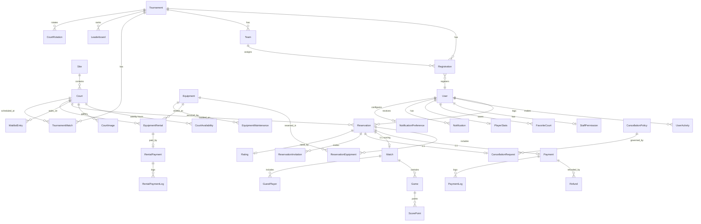

# PickleSphere — Production Readiness Audit (Step 1)

**Date:** 2026-09-30
**Scope:** full repository — `accounts, courts, dashboard, equipment, notifications, payments, reservations, scoring, tournaments, utils, picklesphere`
**Method:** read models, views, forms, urls, signals, consumers, middleware, settings, tests, CI, templates index.
**Status:** findings only. No code changed. Awaiting approval before Step 2.

---

## 0. Executive summary

PickleSphere is a well-organized student project with genuinely thoughtful touches (role-based URL namespaces, CMS models, OTP email verification, WebSocket scaffolding, caches, a real Stripe integration draft, and some targeted tests). It is **not production-ready** in one critical area above all: **money and inventory correctness**.

The three highest-impact problems are:

1. **A free-booking bypass.** Selecting the `card` payment method fabricates a `Payment` marked `paid` and confirms a `Reservation` with **no payment gateway involved** (`payments/views.py` `checkout_page_view` and `payment_checkout_view`).
2. **Double-booking / overbooking races.** Every availability check is a check-then-act with no `select_for_update` and no DB constraint — across reservations, equipment, and admin forms.
3. **Non-atomic payment state.** Stripe webhooks are not idempotent at the delivery level (no event-ID table), can be replayed, never reconcile amount, and ignore `charge.refunded`.

Roughly ~60% of the code is CMS/content plumbing for public pages; the transactional core (reservations, payments, equipment, scoring) is where the risk concentrates. Recommended sequencing in Step 2 is correct as written: reliability/security first, then quality gates, then background jobs.

**PostgreSQL recommendation (requested in Step 2, previewed here): yes, it is worth moving.** The single strongest reason is that PostgreSQL supports `EXCLUDE USING gist (court_id WITH =, daterange(...) WITH &&)` to enforce non-overlap at the database level, plus `SELECT ... FOR UPDATE`, real transactions on the same connection, and sane concurrency. MySQL has no exclusion constraint, so overlap must be enforced in application code — which is exactly the class of bug this codebase already has. Details in §6.

---

## 1. Architecture & data model overview

### 1.1 Stack (as built vs as declared)

| Concern | Declared (README/env) | Actually built |
|---|---|---|
| DB | MySQL / PostgreSQL | **Hard-coded SQLite** (`settings.py` `DATABASES`) |
| Channels | Redis via daphne | **InMemoryChannelLayer** (commented-out Redis) |
| Cache | Redis (`CACHE_BACKEND=redis`) | LocMemCache by default; Redis optional/fallback |
| Sessions | Redis-backed `cached_db` | DB sessions unless Redis enabled |
| Background jobs | — | None (no Celery) |
| API | — | None (ad-hoc JSON views, no DRF) |
| Settings layout | base/dev/prod | Single `settings.py` |

`requirements.txt` and `.env.example` describe a MySQL/Postgres + Redis deployment that `settings.py` does not implement. Docs and code disagree — a deployment will fail or silently run on SQLite.

### 1.2 App responsibilities

- **accounts** — custom `User` (role: super_admin/staff/user), `UserActivity`, `StaffPermission` (granular, unused by decorators), OTP password reset, email-or-username auth backend.
- **courts** — `Site`, `Court`, `CourtAvailability` (weekly hours), `CourtImage`, `FavoriteCourt`; public court list/detail/directions/availability; a shared `_build_time_slots()` helper.
- **reservations** — `Reservation` (also carries match settings + participant FKs), `ReservationEquipment`, `CancellationPolicy`, `CancellationRequest`, `WaitlistEntry`, `ReservationInvitation`. Booking is split across two steps: `reservation_create_view` validates and stashes `checkout_data` in the **session**; `checkout_page_view` creates the row at payment time.
- **payments** — `PaymentSettings` (singleton), `Payment`, `Refund`, `PaymentLog`; GCash/Maya/bank proof uploads, cash counter flow, Stripe Checkout + webhooks.
- **equipment** — `Equipment`, `EquipmentRental`, `RentalPayment`, `EquipmentMaintenance`.
- **scoring** — `Match` (1:1 with Reservation), `Game`, `ScorePoint`, `PlayerStats`, `MatchSettings`, `GuestPlayer`; WebSocket live scoring.
- **tournaments** — `Tournament`, `Team`, `Registration`, `Match`, `Leaderboard`, `MatchNotification`, `CourtRotation`; bracket generation utility.
- **notifications** — `Notification`, `NotificationPreference`, `EmailLog`, `EmailOTP`, `SmtpConfiguration`, `BroadcastMessage`, `NotificationTemplate`; signals fan out per-role notifications.
- **dashboard** — large CMS surface (55+ models: page content, nav/footer/branding/design, testimonials, ratings, contact messages, maintenance mode) plus role dashboards and analytics. `dashboard/views.py` (2,623 lines) coexists with a `dashboard/views/` package and `dashboard/cms_views.py` (1,757 lines).
- **utils** — `SoftDeleteMixin`, admin CRUD helpers.
- **picklesphere** — settings, role-based URL routing, ASGI/routing, session management middleware.

### 1.3 Booking lifecycle (as implemented)

```
RESERVE (session)                     CHECKOUT (creates DB rows)
user fills form ──► ReservationForm.clean ──► overlap SELECT
       │                     │
       └─► _build_time_slots ┘
       │
       ▼
reservation_create_view: re-check overlap + past ──► session['checkout_data']
       │                                                   │
       ▼                                                   ▼
 /user/checkout/<token>/  ──► checkout_page_view
       │
       ├─ method in {gcash,maya,bank_transfer}: GCashPaymentForm ─► Reservation(pending) + Payment(pending)  [manual verify later]
       ├─ method == 'cash':                        Reservation(pending) + Payment(pending)  [counter confirm]
       ├─ method == 'stripe':                      Reservation(pending) + Payment(pending) ─► Stripe Checkout
       └─ method == 'card':                        Reservation(CONFIRMED) + Payment(PAID)  ◄── NO GATEWAY  ⚠️
```

### 1.4 Entity-relationship diagram

Core transactional entities shown; the ~55 CMS models in `dashboard` are omitted for readability (they are mostly page-content singletons).



---

## 2. Findings — Critical

> Fix these before anything else ships to real users/money.

### C1 — Card payment is a free-booking bypass
**Where:** `payments/views.py` — `checkout_page_view` (`method == 'card'` branch) and `payment_checkout_view` (`method == 'card'` branch).
**What:** both branches generate `transaction_id = uuid4()[:8].upper()`, set `payment.status = 'paid'` and `reservation.status = 'confirmed'`, send "Payment successful" email, and **never call Stripe**. `create_payment_intent` is imported but never invoked.
**Impact:** any user books any court at any price for free; revenue loss and bogus confirmed reservations.
**Fix direction:** route all card payments through Stripe (Checkout or PaymentIntent + webhook). Remove the `card` option from user-facing checkout, or gate it behind staff. Never let the client assert payment success.

### C2 — Double-booking race (TOCTOU) on reservations
**Where:** `reservations/forms.py ReservationForm.clean`; `reservations/views.py reservation_create_view`, `approve/edit`, `admin_reservation_create_view`; `payments/views.py checkout_page_view` (overlap check → `Reservation.objects.create`).
**What:** availability is always *check then create* with no `select_for_update` and no DB constraint. Two concurrent requests for the same slot both pass the overlap SELECT and both insert. `Reservation.save()` recomputes totals but never validates overlap.
**Verified:** `select_for_update` appears **nowhere** in the codebase.
**Impact:** overlapping confirmed bookings, double-sold courts, refund/cancellation chaos.
**Fix direction:** wrap creation in `transaction.atomic()` + lock the court row (`Court.objects.select_for_update().get(pk=...)`) or an advisory lock, re-check inside the lock, and add a defense-in-depth strategy (§6).

### C3 — Equipment overbooking / negative stock
**Where:** `equipment/views.py equipment_rental_create_view`; `payments/views.py` equipment attach loops (checkout branches); `reservations/views.py reservation_edit_view` (return/add quantities).
**What:** `quantity_available` is read, compared, then decremented in separate statements with no lock — the classic lost-update race. `ReservationEquipment` also has no unique constraint, so the same equipment can be attached repeatedly.
**Impact:** equipment promised to more renters than exist; stock drifts.
**Fix direction:** `select_for_update` on `Equipment` inside the transaction, or `F('quantity_available') - q` with a guard, and a `ReservationEquipment` unique constraint on `(reservation, equipment)`.

### C4 — Stripe webhooks are not idempotent at the delivery level
**Where:** `payments/webhooks.py`, `payments/stripe_integration.py`.
**What:** signature verification is correct (`stripe.Webhook.construct_event`), but **no Stripe event ID is persisted**. Stripe delivers at-least-once and retries. `handle_checkout_session_completed` has *no* status guard and each delivery: re-marks paid, re-confirms, and creates a **duplicate** `PaymentLog` + `Notification`. Only `handle_payment_intent_succeeded` has a `status != 'pending'` guard.
**Impact:** duplicate notifications/logs; more seriously, a replay after a refund/cancel can re-confirm a reservation and mark it paid again.
**Fix direction:** add a `StripeEvent(id = CharField(unique), type, processed_at)` model, `get_or_create` at the top of the handler, and return 200 early on duplicates. Wrap each handler in one transaction; re-read the Payment row under `select_for_update`.

### C5 — Webhook ignored events leave local state wrong
**Where:** `payments/webhooks.py`.
**What:**
- `charge.refunded` is acknowledged but does nothing — refunds issued from the Stripe dashboard/API never update `Payment`/`Refund`.
- No handling for `charge.refund.updated`, `charge.dispute.created`, `payment_intent.canceled`, `checkout.session.async_payment_failed`.
- `handle_checkout_session_completed` accepts the session's `metadata.payment_id` without verifying the paid **amount and currency** match `payment.amount`.
**Impact:** money state diverges from the ledger; disputes and partial refunds invisible.
**Fix direction:** implement the refund/dispute handlers, and compare `session.amount_total`/`currency` to the local payment before marking paid.

---

## 3. Findings — High

### H1 — WebSocket channel layer breaks under real deployment
`settings.py` uses `InMemoryChannelLayer`; Redis is commented out. With Daphne running multiple workers/processes (and `channels_redis` required for cross-process delivery), live scoring, notifications, and court availability silently only work single-process. `.env.example` implies Redis but nothing wires `CHANNEL_LAYER_TYPE`.

### H2 — Missing object-level permissions and anonymous access in scoring
- `scoring/views.py match_score_api` has **no `@login_required`** — anonymous users can read any match by ID.
- `match_detail_view` and `match_live_view` are `@login_required` but scope `.all()` — any logged-in user can view any match's participants/state.
- `MatchScoreConsumer._can_update_score` lets *any player* set the score, and score changes are **not written to any audit log** (no score-edit trail), contradicting the Step 3 requirement.
- `search_users_api` returns emails/skill of all `user`-role accounts to any authenticated caller (privacy/abuse surface — see also rate limiting M9).

### H3 — `User.email` uniqueness is not enforced at the DB level
`EmailOrUsernameBackend.authenticate` does `UserModel.objects.get(Q(username__iexact=...) | Q(email__iexact=...))`. `User` has no `unique=True` on email (only the **form** checks `email__iexact`). `AdminUserCreateForm`/`AdminUserUpdateForm` don't check. Two accounts with the same email/fold → `MultipleObjectsReturned` and **login failure for legitimate users**. Registration itself races (check-then-create).

### H4 — Abandoned reservations hold inventory indefinitely
Booking rows are created at the payment step and left `pending` for cash/GCash/bank. Only `checkout.session.expired` (Stripe, 1 hour) cancels anything. A user who starts a cash/online submission and walks away blocks the slot forever. No expiry, no nightly cleanup. (Celery in Step 2 addresses this, but until then it's a live inventory leak.)

### H5 — Password reset leaks account existence despite the view
`accounts/forms.py PasswordResetRequestForm.clean_email` raises *"If an active account exists with that email, a reset link will be sent."* — which itself reveals that the email is **not** registered, while `password_reset_request` view deliberately tries to hide this. Contradictory and user-enumerable.

### H6 — Money handled as `float`
`Reservation.save`/`calculate_total`, all checkout branches, refund math, and several views convert `Decimal` → `float` and back. `equipment_fee`/`subtotal`/`total_amount` are `DecimalField` but computed in float. Rounding drift is inevitable; e.g. `total_amount = subtotal + equipment_fee` ignores any future tax/discount.

### H7 — No file-upload validation
Every `ImageField` (profile picture, cover photo, payment/GCash proofs, court/equipment images, CMS media library) accepts any content with no `FileExtensionValidator`, size cap, or content-type check, and media is served directly. A malicious upload is a stored-content/XSS-from-MIME risk and a storage DoS vector. `qr_code`/`gcash_proof_image` are especially sensitive.

### H8 — Unhandled broad exceptions and error leakage
`payments/views.py` wraps checkout in `except Exception as e:` and shows `f'... Error: {str(e)}'` to the user (internal detail leak, and the transaction may partially commit in the non-atomic `payment_checkout_view` path). Notification signals in `notifications/signals.py` wrap everything in bare `except Exception: pass`, so a failing notification is invisible. `courts/consumers.py _get_courts_availability` falls back to `[]` on any error.

### H9 — Payment status `'cancelled'` is invalid
`admin_reservation_delete_view` runs `Payment.objects.filter(...).update(status='cancelled')`, but `Payment.STATUS_CHOICES` has no `'cancelled'`. Data now violates the model's own contract and will render oddly anywhere choices are enforced.

### H10 — Admin reservation CRUD bypasses availability entirely
`admin_reservation_create_view`/`admin_reservation_edit_view` (`AdminReservationForm`) never check overlaps or the past, permit arbitrary `hourly_rate`/`equipment_fee`, and create a `Payment` with no method. Staff can create double bookings through the admin UI too.

---

## 4. Findings — Medium

### Data / queries
- **M1 — `pre_save` signals double every write.** `notifications/signals.py` `reservation_pre_save_handler`/`payment_pre_save_handler` issue a `SELECT` on each save to capture `_old_status`; combined with `SESSION_SAVE_EVERY_REQUEST=True` and per-request CMS reads this adds avoidable load. Use `update_fields`-aware logic or a `django-model-utils`-style field tracker.
- **M2 — Availability is query-heavy.** `_build_time_slots` loads reservations per call; `court.get_time_slots` re-queries per day; `get_monthly_availability_api` calls `court.get_time_slots(d)` for **every day of the month** → ~30+ queries per request. `court_availability_view` has its own divergent slot logic (8–22 vs 8–24) — three implementations of the same rule.
- **M3 — Index gaps.** `Reservation` lacks a composite `(court, date, start_time, end_time)` index matching the overlap predicate; `ReservationEquipment` has no unique index; `EquipmentRental`/`ScorePoint` lack the supporting indexes for their hot filters.
- **M4 — `profile_view` N+1/partial stats.** `wins` is computed by iterating only the first 10 matches (often `match_history`), and reservation counts are five separate `COUNT(*)` queries; `favorite_courts` is a separate aggregate.
- **M5 — Unbounded lists.** `match_list_view`, `leaderboard_view`, `equipment_list_view`, `notifications` list, and tournament public lists lack pagination (some slice arbitrarily).
- **M6 — `notifications/signals.py` fan-out is O(users).** Every new reservation fans out to all staff *plus* `Notification` per row; `BroadcastMessage` similarly. No batching/throttling.

### Correctness / config
- **M7 — Timezone inconsistency.** Forms use naive `datetime.now()` (`reservations/forms.py`, `courts/views.py _build_time_slots`) while views use `timezone.now()`; `TIME_ZONE='Asia/Manila'`, `USE_TZ=True`. "Past slot" boundaries can be off by the UTC offset.
- **M8 — Session settings conflict.** `SESSION_TIMEOUT=1800` vs `SESSION_COOKIE_AGE=3600`; the custom session middleware and `SESSION_SAVE_EVERY_REQUEST` cause a DB write per request on db sessions.
- **M9 — OTP rate limiting is IP-only.** `resend_otp_view` keys the cache on `REMOTE_ADDR` only; shared/NAT IPs throttle each other, and a single attacker behind many IPs isn't limited. `cleanup_expired_otps()` runs on every verify GET (a DELETE each time).
- **M10 — `CancellationPolicy` created implicitly.** `cancel_reservation_view` creates a default policy on the fly if none exists; `_get_cancellation_time_limit()` silently defaults to 20 — policy drift and race on creation.
- **M11 — Duplicated concepts.** Guest players live in both `Reservation.guest_players_data` (JSON) and `scoring.GuestPlayer`; match-format/scoring choice tuples are redefined in `reservations`, `scoring`, and `payments`.
- **M12 — `dashboard/views.py` (2,623 lines), `dashboard/cms_views.py` (1,757), `_scan_tmp.py`, `_split_tmp.py`** suggest abandoned refactor scaffolding. Dead code raises maintenance cost and audit risk.
- **M13 — Maintenance mode uses `timezone.timedelta`** (works only because Django's `timezone` re-exports it) and caches for 30s, so a maintenance toggle can lag; it also blocks the `render()` path for all non-admins including password reset — confirm that's intended.
- **M14 — CSP absent.** No Content-Security-Policy is set anywhere; Django 4.2 doesn't ship one. Templates inline styles/scripts (CMS design system) make this non-trivial but it's a stated requirement.
- **M15 — CMS content is cached but `dashboard/cache_signals.py` coverage is unclear** — stale public pages are a likely bug class; verify invalidation on every CMS write.

### Testing & CI
- **M16 — CI runs almost nothing.** `django-tests.yml` runs **only** `accounts.tests`, then `check --deploy` whose warnings are swallowed by `|| echo`. `reservations`, `payments`, and `tournaments` tests exist but are **never executed in CI**. No coverage, no lint, no `makemigrations --check`, no dependency audit. The pip fallback can install an incomplete dependency set and still "pass".
- **M17 — Coverage near zero on the risky apps.** Tests exist for accounts (models/forms), payments (checkout + webhooks), reservations (booking flow), tournaments (brackets), dashboard (safe rendering), utils. **Zero** tests for `scoring`, `equipment`, `notifications`, `courts`, and no integration test for the full book→pay→confirm path or the race conditions above.
- **M18 — No settings split / no test settings.** A single `settings.py` with SQLite hard-coded; tests rely on `override_settings(PASSWORD_HASHERS=...)` per class rather than a `TestSettings`. `mysqlclient` in requirements is unused.

---

## 5. Findings — Low

- **L1** `ALLOWED_HOSTS` unconditionally appends four `*.ngrok*` wildcard patterns even in production.
- **L2** `CSRF_TRUSTED_ORIGINS` hard-codes `localhost:8001`; `9000`/`8001` port assumptions are baked in.
- **L3** `WHITENOISE_AUTOREFRESH` unset (dev-only static staleness); `STATICFILES_DIRS` + `static()` in urls only when DEBUG.
- **L4** Unused imports/vars across `accounts/views.py` (`UserRoleForm`, `staff_or_admin_required`), `payments/views.py` (`create_payment_intent`, `HttpResponse`, `Http404`, `ExtractHour`, many `F`/`ExpressionWrapper`), `reservations/views.py` (`AdminReservationForm` imported but unused).
- **L5** `StaffPermission` granular model exists but **no decorator or view consults it** — staff permissions are effectively all-or-nothing by role.
- **L6** `User.sync_employment_status` in `save()` means any `is_active=False` silently flips `employment_status`, including Django admin bulk ops.
- **L7** `dashboard/views/admin_panel.py admin_reject_testimonial_view` is `@login_required` only (no `@admin_required`) — harmless today because the body is a no-op redirect, but it's a latent permission miss pattern.
- **L8** `.env` is committed (should be git-ignored; verify no secrets in history).
- **L9** `run_server.sh` starts `runserver 0.0.0.0` and ngrok by default via flag — fine for dev, dangerous if copied to prod.
- **L10** README/env describe MySQL; `settings.py` says SQLite with a note to switch manually. Documentation/implementation drift will bite deployment.

---

## 6. PostgreSQL vs MySQL (decision preview)

**Recommendation: migrate to PostgreSQL.** Reasons, in priority order:

1. **Overlap integrity is enforceable in the DB.** PostgreSQL:
   ```sql
   CREATE EXTENSION btree_gist;
   ALTER TABLE reservations ADD CONSTRAINT no_overlap
     EXCLUDE USING gist (
       court_id WITH =,
       daterange(date + start_time, date + end_time, '[)') WITH &&
     ) WHERE (status IN ('pending','confirmed'));
   ```
   MySQL has **no exclusion constraints**, so every overlap rule stays in application code forever — the exact source of C2/C3/H10. A DB constraint is the only race-proof backstop.
2. **Predictable transactions/concurrency** — proper `READ COMMITTED` + row locks with `select_for_update`, plus `NOWAIT`/`SKIP LOCKED` for job queues (waitlist, expiry sweeps).
3. **Real JSONB + GIN indexes** for `amenities`, `guest_players_data`, `target_roles`, reducing ad-hoc JSON filtering.
4. **PostgreSQL is what `channels-redis`/Celery/Daphne deployments assume**, and it's the default on most managed platforms (Neon/Supabase/RDS/Fly).

**Cost:** medium — but the DB is currently SQLite, so *any* move is a migration anyway. Switching to Postgres now (rather than to MySQL) is strictly better for this domain. If the team is constrained to MySQL (institutional requirement), the fallback is: `SELECT ... FOR UPDATE` on the court row + a `ReservationSlotLock` table with a unique `(court, date, slot_start)` key. That works but is more code and easier to get wrong.

**Django note:** the `daterange` constraint needs a `RangeField` (`django.contrib.postgres`) or a raw migration `RunSQL`; both are reversible (`DROP CONSTRAINT`). We'll validate all migrations are reversible and safe on existing data as required.

---

## 7. Test coverage gaps (target for Step 2)

| Area | Existing tests | Gap |
|---|---|---|
| reservations | booking flow (happy + overlap + past) | races, checkout→payment integration, cancellation/refund, edit window, equipment attach |
| payments | checkout flow, Stripe webhooks | card bypass removal, idempotency/event store, amount verification, refunds, cash counter |
| scoring | none | score engine, win-by-two, best-of-N, WebSocket auth, stats |
| equipment | none | rental/cancel/checkout/checkin, stock races, payments |
| notifications | none | preference filtering, dedup, fan-out, email/WebSocket |
| courts | none | slot builder, monthly availability, favorites |
| tournaments | bracket generation | registration, seeding, live matches |
| accounts | models/forms | 80%+ requires auth backend, OTP flows, permissions |
| dashboard | safe rendering | CMS invalidation, analytics, permissions |

CI must run **all** app test suites with coverage on `reservations`, `payments`, `scoring` ≥ 80%.

---

## 8. Ranked backlog (proposed Step 2 order)

**Reliability & security (P0)**
1. Remove the fake `card` path; force Stripe for card (`C1`).
2. `transaction.atomic` + `select_for_update` + overlap re-check for reservations; add DB-level guard (`C2`).
3. Same locking for equipment quantity (`C3`).
4. Stripe event-ID idempotency table + per-event transaction (`C4`).
5. Implement `charge.refunded`/dispute handlers + amount/currency verification (`C5`).
6. Object-level permissions on scoring views/consumer + score-edit audit log (`H2`).
7. `User.email` unique constraint + migration handling existing dupes (`H3`).
8. Reservation auto-expiry for unpaid holds (`H4`).
9. Env-based settings, secure cookies, HSTS, CSP, ALLOWED_HOSTS, file-upload validation (`H7`, `M14`, `L1`).
10. Roles: formalize player/staff/admin (+ optional facility owner) with real object-level checks everywhere (`H10`).

**Quality (P1)** — pytest + factory_boy (80% on reservations/payments/scoring), ruff/black/mypy + pre-commit, CI: lint + all tests + coverage + `makemigrations --check` + `pip-audit` (`M16`, `M17`).

**Background jobs (P2)** — Celery + Redis for unpaid-reservation expiry, reminders, no-show, reports (`H4`, `M6`).

**Then:** Postgres migration (§6) should land alongside or just before the reservation-locking work so the DB constraint can be added in the same phase.

---

## 9. What I did NOT do

- No code or migration changes (per your Step 1 instruction).
- Did not run the test suite or a server (audit is static reading; none of the findings above were confirmed by execution — C1–C5 and H2 are unambiguous from source, but I can add failing tests to prove each in Step 2).
- Did not exhaustively read the ~55 dashboard CMS models or every template byte; the CMS surface is lower-risk and I'll deep-dive per feature.

---

## 10. Awaiting your approval

Please confirm:
1. **Approve Step 2 start**, and
2. **Decision: PostgreSQL migration (recommended)** vs staying on MySQL with an application-level lock table, and
3. Whether removing the `card` option from user checkout (until Stripe card is wired) is acceptable, or it must be replaced same-session with Stripe.

Once approved I'll begin Step 2 in small Conventional-Commit branches, tests with each fix, starting with C1→C2→C3→C4→C5.
